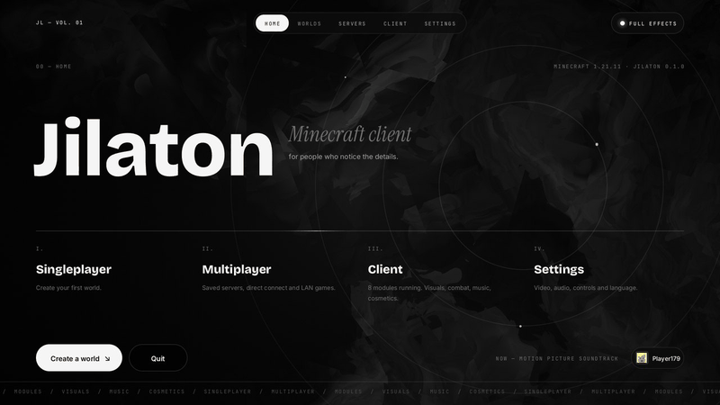

<div align="center">



<a href="#-install">
  
</a>

<br/>


<br/><br/>



</div>


### `01 — THE IDEA`

Jilaton started as a personal project: what would a Minecraft client look like if it were designed like a
modern editorial website instead of a debug menu? The answer is one design system end to end. Heavy display
type sits against italic serif accents, with monospace section labels and hairline rules. Live GPU shaders run
behind the menus, and every hover, press and panel shares the same spring motion.


### `02 — INTERFACE`

<table>
  <tr>
    <td width="50%"><br/><sub><b>HOME</b> · live shader background, kinetic wordmark, sliding navigation</sub></td>
    <td width="50%"><br/><sub><b>LOADING</b> · driven by real resource-loading progress</sub></td>
  </tr>
  <tr>
    <td><br/><sub><b>CLICKGUI</b> · numbered categories, live previews, light sweeps on hover</sub></td>
    <td><br/><sub><b>SETTINGS</b> · only the switch toggles; the card opens settings</sub></td>
  </tr>
  <tr>
    <td><br/><sub><b>THEME</b> · seven presets, accent, motion, blur, GUI size</sub></td>
    <td><br/><sub><b>PAUSE</b> · real GPU blur with a live session panel</sub></td>
  </tr>
  <tr>
    <td><br/><sub><b>HUD</b> · widgets with a drag, snap and align editor</sub></td>
    <td><br/><sub><b>MUSIC</b> · Spotify or local files with synced lyrics</sub></td>
  </tr>
</table>


### `03 — IN THE WORLD`

<table>
  <tr>
    <td width="50%"><br/><sub><b>FINISHER</b> · a 3D character finishes what you defeat, with a crowd and kill effects</sub></td>
    <td width="50%"><br/><sub><b>XRAY</b> · terrain fades so ores show through</sub></td>
  </tr>
  <tr>
    <td><br/><sub><b>STORAGE ESP + BREADCRUMBS</b></sub></td>
    <td><br/><sub><b>WAYPOINTS</b> · beams and distance labels</sub></td>
  </tr>
</table>


### `04 — WHAT'S INSIDE`

| | |
|---|---|
| **Shader backgrounds** | Dark Veil, Aurora, Threads, Beams, Galaxy and Liquid Chrome, written in GLSL for Minecraft's GUI pipeline. They follow the cursor. |
| **Presets** | Jilaton, Editorial, Cyber, Monochrome, Glass, Cinematic, Performance. Each one changes the shader, accent, motion, blur and quality together. |
| **Configs** | Profiles, clipboard import/export, per-module reset, and search that also matches setting names. |
| **Finisher** | Ground slam, Rising uppercut, Spin kick and Tung tung bonk, with twelve kill effects and a crowd of 3D characters. |
| **Cosmetics** | 3D characters, wings, halos, knives, swing animations and a view-model editor. |

<details>
<summary><b>Browse the modules</b></summary>
<br/>

**Combat** · KillAura, AimAssist, Triggerbot, Criticals, Velocity, CrystalAura, AnchorAura, AutoTotem, AutoArmor, AutoWeapon, AntiBot, Teams, Friends …<br/>
**Movement** · Sprint, Speed, Flight, Step, Spider, Sneak, SafeWalk, AutoWalk, LongJump, TargetStrafe, NoSlow …<br/>
**Player** · AutoTool, AutoFish, AutoEat, AutoRespawn, InventoryCleaner, ChestStealer, ChestCleaner, SpeedMine, Replenish …<br/>
**Visuals** · Finisher, TargetESP, StorageESP, BlockESP, XRay, Trajectories, Waypoints, Breadcrumbs, NoRender, Time Changer, Custom Sky, Wings, Halo, Swing Animations …<br/>
**Client** · HUD, Notifier, Macros, AutoReconnect, Music Center …

</details>


### `05 — INSTALL`

1. Install [Fabric Loader](https://fabricmc.net/use/) **0.20.1 or newer** for Minecraft **1.21.11**.
2. Drop [Fabric API](https://modrinth.com/mod/fabric-api) and the Jilaton jar into `mods`.
3. Launch on Java 21 and press **Right Shift**.

```bash
# or build it yourself
cd JilatonClient && ./gradlew build   # → build/libs/
```

> Some modules change gameplay and may break a server's rules. Use them where they are allowed.


### `06 — CREDITS`

Licensed under [GPL-3.0](LICENSE). Parts are adapted from [LiquidBounce](https://github.com/CCBlueX/LiquidBounce) and the
Anubis client (GPL-3.0, Horcus and 4ldenz); every source is listed in [ATTRIBUTION.md](JilatonClient/ATTRIBUTION.md).
Type: Inter, JetBrains Mono, Bricolage Grotesque and Instrument Serif (SIL OFL).

<div align="center">
<br/>
<sub><code>JL — VOL. 01</code> &nbsp;·&nbsp; made by <a href="https://github.com/Osayeidzaber">Osayeed</a></sub>
</div>
