<div align="center">

# Jilaton

**A Fabric client for Minecraft 1.21.11: an editorial, shader-driven interface, 118 modules, and 3D cosmetics.**


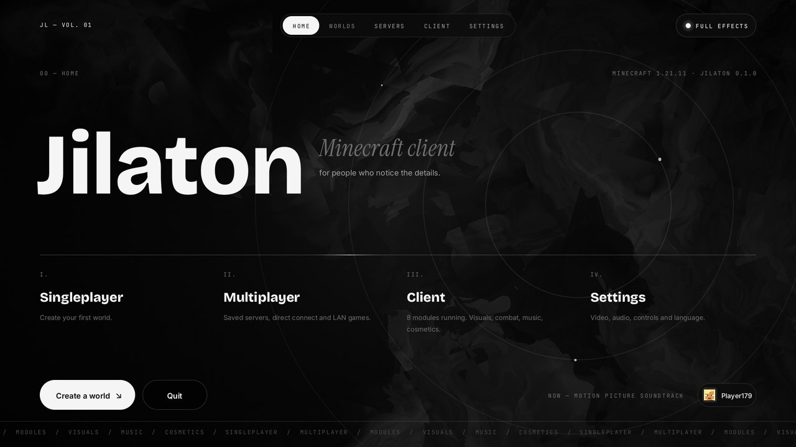

</div>

---

## Overview

Jilaton is a personal project: a complete Minecraft client built as a Fabric mod. The whole interface was
redesigned from scratch in an editorial style (big display type, italic serif accents, monospace section labels,
hairline rules) running on real GPU shader backgrounds, and every screen shares one design system for colour,
type and motion.

## Interface

| | |
|---|---|
| 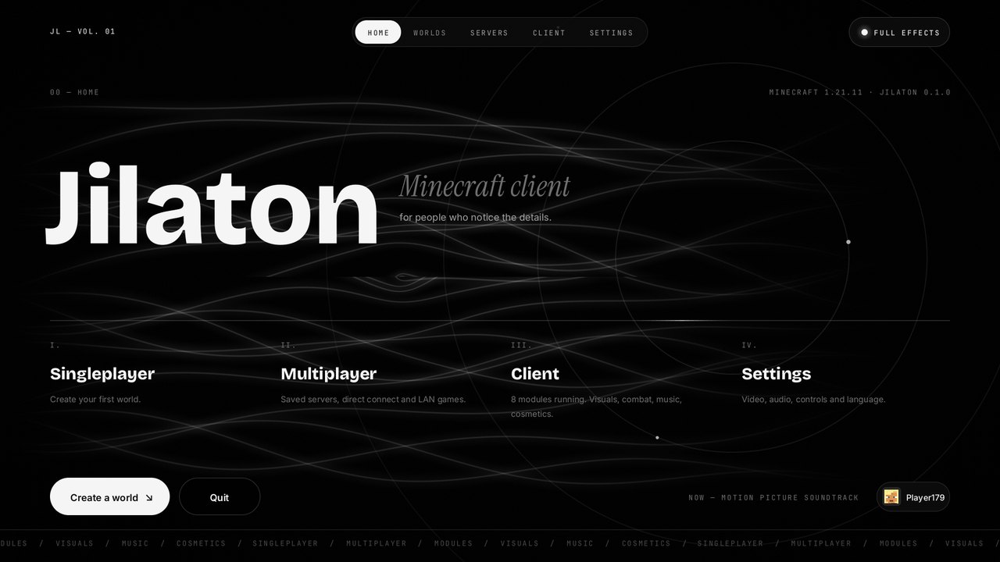 | 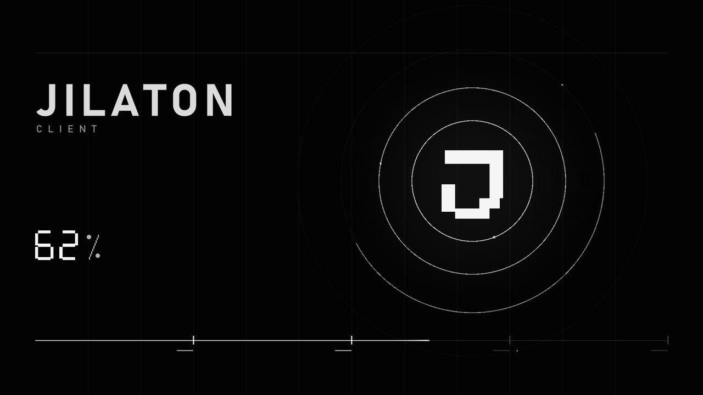 |
| **Home** with a live shader background, kinetic wordmark and sliding navigation | **Loading** driven by real resource-loading progress |
| 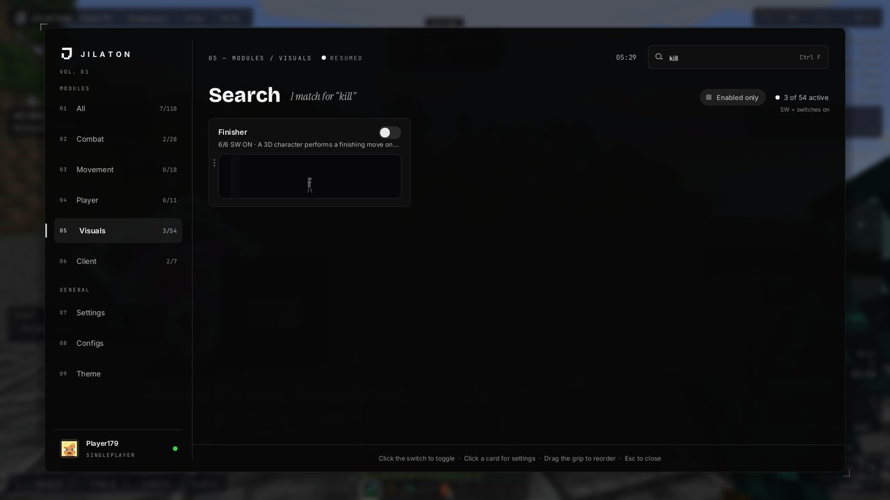 | 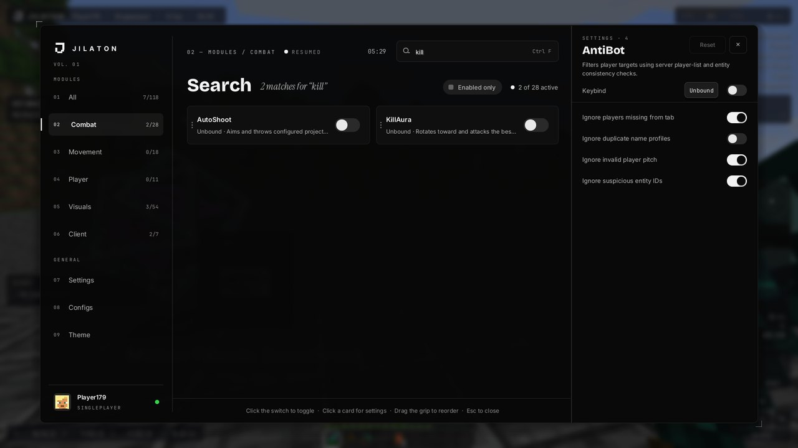 |
| **ClickGUI**: numbered categories, live module previews, light sweeps on hover | **Settings drawer**: only the switch toggles a module, the card opens its settings |
| 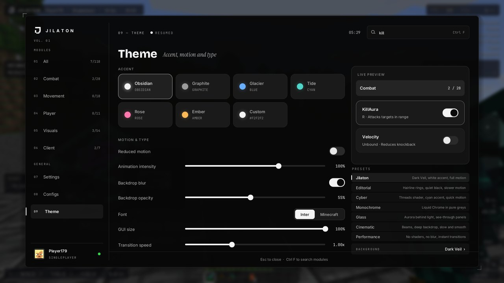 | 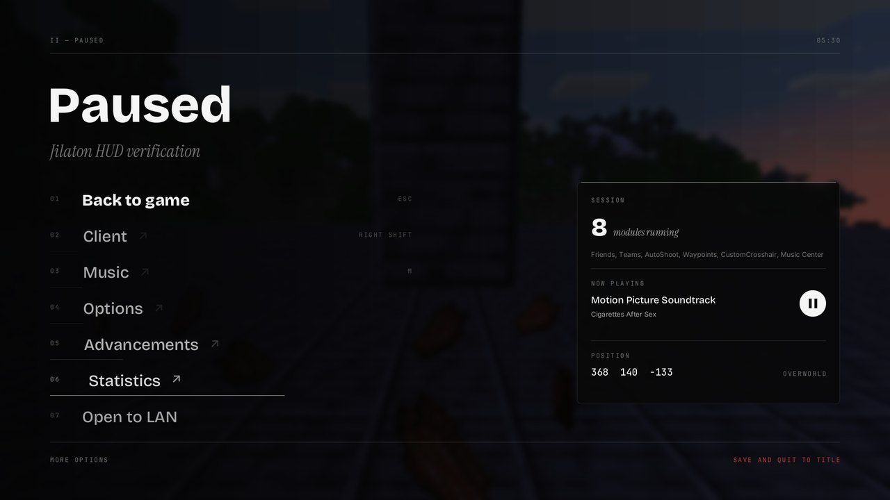 |
| **Theme**: presets, accent, motion, blur, GUI size and background | **Pause** over a real GPU blur, with a live session panel |
| 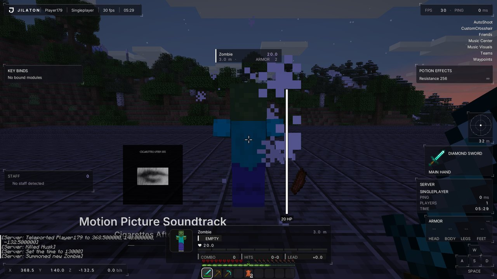 | 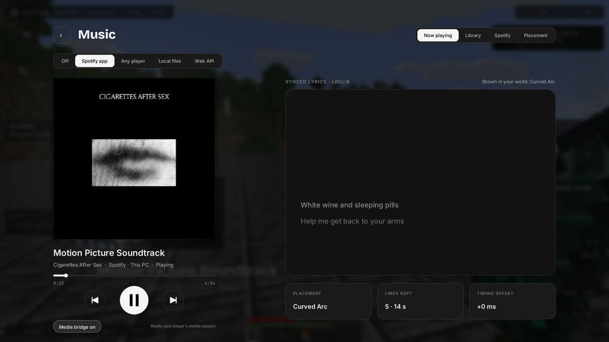 |
| **HUD** widgets with a drag-and-snap editor | **Music** center with synced lyrics |

## Gameplay and visuals

| | |
|---|---|
| 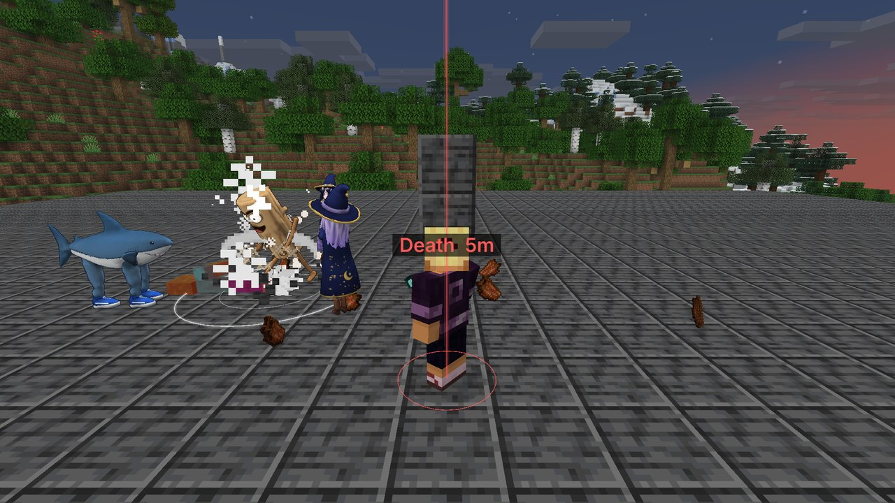 | 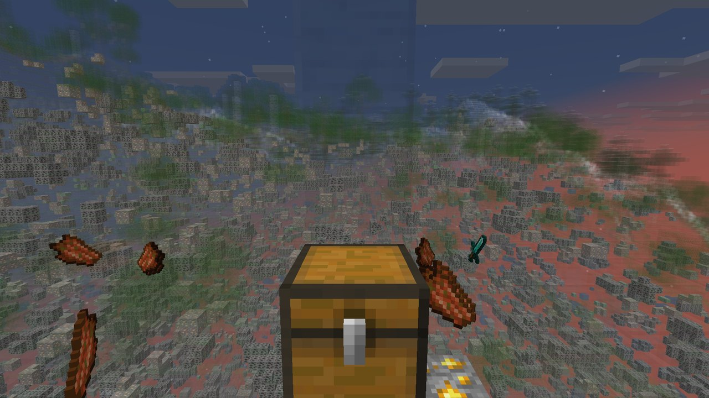 |
| **Finisher**: a 3D character performs a finishing move on what you defeat, with kill effects and a crowd | **XRay** fades the terrain so ores show through |
| 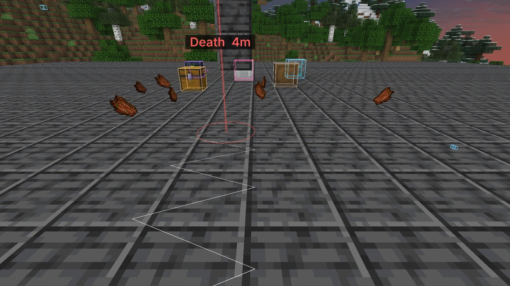 | 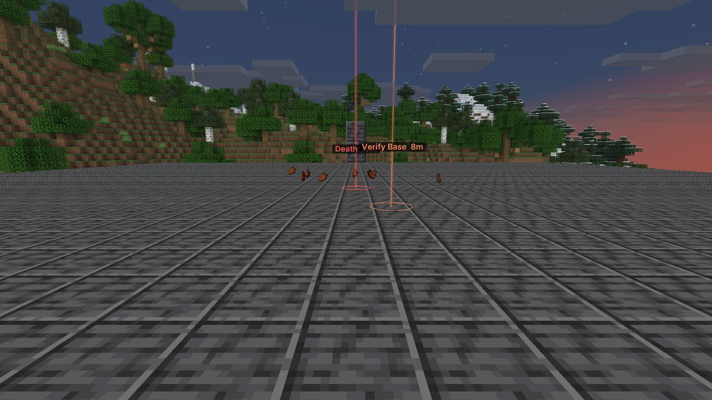 |
| **StorageESP** and **Breadcrumbs** | **Waypoints** with beams and distance labels |

## Features

- **Shader backgrounds**: Dark Veil, Aurora, Threads, Beams, Galaxy and Liquid Chrome, written in GLSL for
  Minecraft's GUI pipeline and reacting to the cursor.
- **Customization**: seven interface presets (Jilaton, Editorial, Cyber, Monochrome, Glass, Cinematic,
  Performance), accent colours, fonts, GUI size, transition speed, blur, transparency and a Full Effects switch.
- **Configs**: profiles, clipboard import/export, per-module reset, and search that matches setting names.
- **Modules** across Combat, Movement, Player, Visuals and Client, including AutoTool, AutoFish,
  InventoryCleaner, ChestStealer, ChestCleaner, AutoWalk, AutoReconnect, Notifier, Macros, Trajectories,
  StorageESP, BlockESP, Waypoints, Breadcrumbs, XRay, NoRender, Time Changer and more.
- **3D cosmetics**: built-in 3D characters, wings, halos, knives, swing animations and a view-model editor.
- **Finisher**: Ground slam, Rising uppercut, Spin kick and Tung tung bonk, with twelve kill effects.

## Install

1. Install [Fabric Loader](https://fabricmc.net/use/) **0.20.1 or newer** for Minecraft **1.21.11**.
2. Put [Fabric API](https://modrinth.com/mod/fabric-api) and the Jilaton jar in your `mods` folder.
3. Launch with Java 21. Open the client menu with **Right Shift**.

> Some modules change gameplay and may be against the rules of multiplayer servers. Use them where they are
> allowed.

## Build

```bash
cd JilatonClient
./gradlew build
```

The jar is written to `JilatonClient/build/libs/`. See [BUILDING.md](JilatonClient/BUILDING.md) for details.

## Credits and license

Jilaton is licensed under the [GPL-3.0](JilatonClient/LICENSE). Parts are adapted from
[LiquidBounce](https://github.com/CCBlueX/LiquidBounce) (GPL-3.0) and the Anubis client (GPL-3.0, Horcus and
4ldenz); see [ATTRIBUTION.md](JilatonClient/ATTRIBUTION.md) for every source. Fonts: Inter, JetBrains Mono,
Bricolage Grotesque and Instrument Serif, all under the SIL Open Font License.
